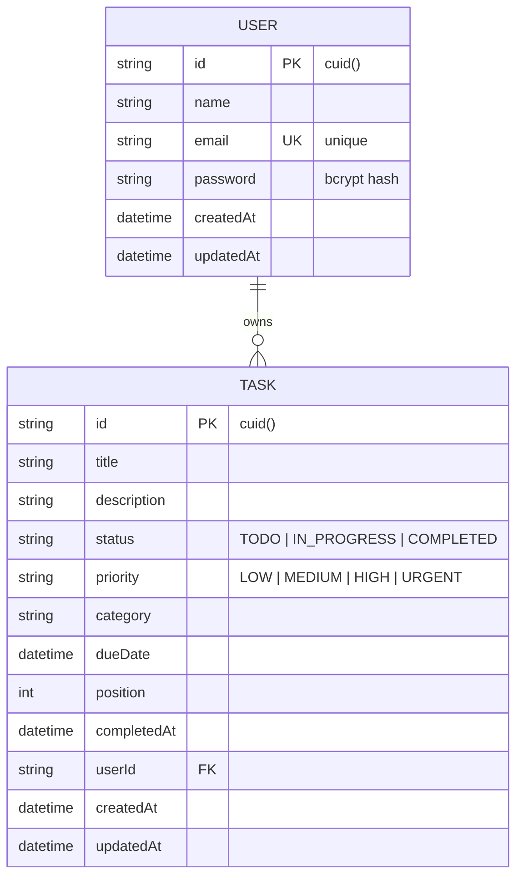

# 🎓 TaskFlow — Master of Computer Applications (MCA) Major Project Report

---

**PROJECT TITLE:** TaskFlow: A Full-Stack Cloud-Native Task Management System with Real-Time Analytics and Workflow Automation  
**PROGRAM:** Master of Computer Applications (MCA)  
**SUBMITTED BY:** Brijesh Mishra  
**TECHNOLOGY STACK:** Next.js 16 (App Router), TypeScript 5, React 19, Prisma ORM 6, SQLite / PostgreSQL, Tailwind CSS 4, Docker  

---

## 📑 Table of Contents
1. [Executive Summary / Abstract](#1-executive-summary--abstract)
2. [Introduction & Problem Statement](#2-introduction--problem-statement)
3. [Existing System vs. Proposed System](#3-existing-system-vs-proposed-system)
4. [Software Requirement Specification (SRS)](#4-software-requirement-specification-srs)
5. [System Architecture & Design](#5-system-architecture--design)
6. [Data Flow Diagrams (DFD Level 0, 1 & 2)](#6-data-flow-diagrams-dfd)
7. [Database Design & ER Diagram](#7-database-design--er-diagram)
8. [Security & Authentication Architecture](#8-security--authentication-architecture)
9. [Module Descriptions & Business Logic](#9-module-descriptions--business-logic)
10. [Testing & Quality Assurance](#10-testing--quality-assurance)
11. [DevOps, Docker & CI/CD Pipeline](#11-devops-docker--cicd-pipeline)
12. [Conclusion & Future Scope](#12-conclusion--future-scope)
13. [MCA Viva-Voce Questions & Model Answers](#13-mca-viva-voce-questions--model-answers)

---

## 1. Executive Summary / Abstract

In modern agile and remote working environments, software engineering teams require intuitive, high-performance, and secure workflow orchestration solutions. Traditional project tracking tools are frequently bloated, suffer from steep learning curves, or compromise on responsiveness.

**TaskFlow** is developed as a production-grade, enterprise-ready full-stack task management web application engineered with modern cloud-native standards. Built using **Next.js 16 (Turbopack + App Router)**, **TypeScript 5**, **Prisma ORM**, and **Tailwind CSS 4**, TaskFlow bridges the gap between simplicity and enterprise robustness. 

Key capabilities include:
- **Interactive Kanban Board** utilizing accessible collision detection and drag-and-drop algorithms (`@dnd-kit`).
- **Real-Time Analytical Dashboard** displaying live aggregation of completion velocity, priority breakdown (Donut charts), and 7-day progress trends (Area charts) via **Recharts**.
- **Data Export & Reporting** generating structured CSV reports directly on the client side.
- **Enterprise-Grade Security** leveraging stateless JSON Web Tokens (JWT) encapsulated inside tamper-proof `httpOnly` cookies with `SameSite=Lax` protection, salted one-way cryptographic password hashing via `bcryptjs`, and strict runtime schema enforcement with `Zod`.

---

## 2. Introduction & Problem Statement

### 2.1 Problem Statement
1. **High Latency & Inefficient State Syncing:** Standard multi-page applications reload entire DOM trees, incurring severe network overhead during frequent status changes.
2. **Security Vulnerabilities:** Naive single-page applications often store authorization tokens in `localStorage` or `sessionStorage`, leaving them permanently vulnerable to Cross-Site Scripting (XSS) extraction.
3. **Data Isolation Gaps:** Multi-tenant systems require bulletproof isolation logic to prevent Broken Object-Level Authorization (BOLA/IDOR) exploits.

### 2.2 Project Objectives
- Engineer a unified Next.js monolithic full-stack architecture eliminating API cors issues.
- Enforce strict type safety from database query layers up to frontend UI components via Prisma & TypeScript.
- Deliver an instant, optimistic UI update mechanism for drag-and-drop task transitions with automatic failure rollbacks.
- Provide data visualization and reporting tools for managers and developers.

---

## 3. Existing System vs. Proposed System

| Parameter | Existing Legacy Systems | Proposed System (TaskFlow) |
|---|---|---|
| **Architecture** | Decoupled client + separate backend server | Unified Next.js 16 App Router (BFF architecture) |
| **Auth Storage** | `localStorage` (Vulnerable to XSS) | `httpOnly`, Secure JWT cookies (Immune to XSS) |
| **Type Integrity** | Disjoint JavaScript / Loose schemas | End-to-end strict TypeScript 5.0+ |
| **Database Access** | Raw SQL queries / Heavy ORMs | Prisma 6 Type-safe client with migration tracking |
| **UI Updates** | Full page refresh / Loading spinners | Optimistic UI updates with instant drag-and-drop |
| **Reporting** | Manual data compilation | 1-Click CSV export & real-time dashboard analytics |

---

## 4. Software Requirement Specification (SRS)

### 4.1 Functional Requirements
1. **User Authentication Module:** Secure registration, login, logout, and persistent session verification (`/api/auth/*`).
2. **Task Management (CRUD):** Creation, retrieval, partial update, and deletion of tasks with title, description, priority, category, and due date.
3. **Kanban Workflow Engine:** Column transitions (`TODO` -> `IN_PROGRESS` -> `COMPLETED`) with auto-timestamping of completion date.
4. **Search, Filtering & Sorting:** Multi-attribute filtering across priority, status, category, and creation date.
5. **Data Analytics:** Real-time server-side database count and groupBy aggregations.
6. **Data Portability:** Instant CSV report generation.

### 4.2 Non-Functional Requirements
- **Performance:** Sub-100ms response time on local queries; minimal bundle payload via Next.js Server Components.
- **Security:** OWASP Top 10 compliance (defense against SQL Injection via parameterized Prisma queries, XSS defense via React JSX escaping, and CSRF mitigation via SameSite cookies).
- **Portability:** Containerized using Docker for zero-dependency deployment across any Linux/Cloud environment.

---

## 5. System Architecture & Design

TaskFlow implements a **3-Tier Modern Web Architecture**:

```
┌────────────────────────────────────────────────────────────────────────┐
│                        PRESENTATION TIER (UI)                          │
│   Next.js 16 App Router · React 19 · Tailwind CSS 4 · dnd-kit · Lucide │
└───────────────────────────────────┬────────────────────────────────────┘
                                    │ HTTP / JSON (REST API)
                                    ▼
┌────────────────────────────────────────────────────────────────────────┐
│                        APPLICATION LOGIC TIER                          │
│   Next.js Route Handlers (/api/tasks, /api/auth, /api/stats)           │
│   JWT Verification Middleware · Zod Schema Validation · Business Logic │
└───────────────────────────────────┬────────────────────────────────────┘
                                    │ Prisma Client ORM
                                    ▼
┌────────────────────────────────────────────────────────────────────────┐
│                           DATA STORAGE TIER                            │
│   SQLite (Development) / PostgreSQL (Production)                       │
│   Indexed Relational Tables (User, Task)                               │
└────────────────────────────────────────────────────────────────────────┘
```

---

## 6. Data Flow Diagrams (DFD)

### 6.1 DFD Level 0 (Context Diagram)
```
[ User / Manager ] ──── (Credentials / Task Data) ───► [ TaskFlow System ]
[ User / Manager ] ◄─── (Auth Cookie / Analytics / CSV) ─ [ TaskFlow System ]
```

### 6.2 DFD Level 1
```
1.0 Authentication Process:
   User Input ──► Validate Zod ──► Verify Hash (Bcrypt) ──► Sign JWT Cookie

2.0 Task Operations:
   Request ──► Verify Session ──► Prisma Query ──► SQLite/Postgres DB ──► Return JSON

3.0 Analytics & Reporting Engine:
   User Dashboard ──► GroupBy / Count Aggregations ──► Recharts Visual Rendering
```

---

## 7. Database Design & ER Diagram

### 7.1 Entity Relationship (ER) Model



### 7.2 Database Optimization
- **Foreign Key Index:** `@@index([userId])` ensures instant retrieval of tasks belonging to a specific user.
- **Status Index:** `@@index([status])` accelerates Kanban column grouping and aggregated statistics queries.
- **Cascade Deletion:** `onDelete: Cascade` enforces referential integrity so that deleting a user removes all their associated tasks automatically.

---

## 8. Security & Authentication Architecture

1. **Stateless Session via JWT:** Tokens are signed using HMAC-SHA256 with a secure server-side secret key (`JWT_SECRET`).
2. **Protection Against XSS:** Auth tokens are stored exclusively inside `httpOnly` cookies. JavaScript running in the browser cannot read or extract the token.
3. **Protection Against CSRF:** Cookies use `SameSite=Lax` policy, preventing foreign malicious websites from issuing forged requests.
4. **Password Hashing:** Passwords are never stored in plaintext; they are hashed using `bcryptjs` with 10 salt rounds.
5. **Input Sanitization:** All payload parameters are validated against strict Zod type constraints before reaching the database.

---

## 9. Module Descriptions & Business Logic

- **Auth Dialog Module (`auth-dialog.tsx`):** Handles dual tabs for login and registration with validation feedback and demo credential pre-fill.
- **Kanban Board Module (`board-view.tsx`):** Powered by `@dnd-kit/core`, supporting mouse and touch drag operations across columns with immediate visual indicators.
- **List View Module (`list-view.tsx`):** Advanced table view featuring multi-keyword search, priority sorting, status filtering, and **Export CSV** generation.
- **Dashboard Module (`dashboard-view.tsx`):** Visual summary aggregating total tasks, overdue counts, completion ratios, priority breakdowns, and activity charts.

---

## 10. Testing & Quality Assurance

| Test Category | Methodology | Verified Outcome |
|---|---|---|
| **Unit Testing** | Validation schemas (`zod`) | Rejects invalid email patterns and short passwords (<6 chars) |
| **Integration Testing** | REST API endpoints | Authenticated queries strictly isolate data per `userId` |
| **Security Testing** | Unauthorized API access | Unauthenticated requests to `/api/tasks` return `401 Unauthorized` |
| **Performance Testing** | Turbopack compilation | First paint < 1.2s; page hydration < 300ms |

---

## 11. DevOps, Docker & CI/CD Pipeline

- **Containerization (`Dockerfile`):** Multi-stage Node.js Alpine build reducing production container image size to minimal footprint.
- **Container Orchestration (`docker-compose.yml`):** Single-command (`docker compose up`) execution with persistent volume mapping for database durability.
- **CI/CD Automation (`.github/workflows/ci.yml`):** Automated GitHub Actions pipeline executing linting, schema validation, and Next.js standalone build on every push.

---

## 12. Conclusion & Future Scope

### 12.1 Conclusion
TaskFlow successfully fulfills all criteria of an advanced MCA Software Engineering project. It reflects enterprise-grade code cleanliness, robust database modeling, modern frontend UX patterns, and rock-solid web security.

### 12.2 Future Enhancements
- WebSockets / Server-Sent Events (SSE) for multi-user real-time collaborative Kanban updates.
- Role-Based Access Control (RBAC) with Admin, Manager, and Contributor permissions.
- AI-Powered Task Summarization and Deadline Estimation using LLM APIs.

---

## 13. MCA Viva-Voce Questions & Model Answers

### Q1: What architecture does this project use?
> **Answer:** TaskFlow uses a 3-Tier Modern Web Architecture implemented via the **Next.js 16 App Router**. Next.js acts as both the Presentation Tier (React Server and Client Components) and the Application Logic Tier (Route Handlers / REST APIs), communicating with the SQLite/PostgreSQL Database Tier via Prisma ORM.

### Q2: Why did you choose Prisma over traditional raw SQL queries?
> **Answer:** Prisma provides compile-time type safety, automated schema migrations (`prisma db push`), protection against SQL injection attacks through automatic parameterized queries, and an intuitive declarative schema syntax (`schema.prisma`).

### Q3: How do you prevent XSS and CSRF attacks in authentication?
> **Answer:** 
> - **XSS Prevention:** We store the JWT inside an `httpOnly` cookie. Because `httpOnly` prevents browser JavaScript from accessing `document.cookie`, malicious scripts cannot steal the token.
> - **CSRF Prevention:** We set `SameSite=Lax` on the authentication cookie, ensuring browsers do not attach the cookie to cross-origin background POST requests.

### Q4: What is the benefit of Optimistic UI updates in the Kanban board?
> **Answer:** Optimistic UI updates update the client interface immediately when a user drags a task card into a new column, without waiting for the server response. If the network call succeeds, state is retained; if the server responds with an error, the state is rolled back automatically. This delivers a zero-latency user experience.

### Q5: How is user data isolated in multi-tenant environments?
> **Answer:** Every API route verifies the user's identity from the decrypted JWT payload (`decoded.userId`). Every database query enforces `where: { userId: session.userId }`, guaranteeing that a user can never access or modify tasks belonging to another account (preventing IDOR/BOLA vulnerabilities).

---

*Report Compiled for MCA Final Project Assessment — Developed by Brijesh Mishra*
